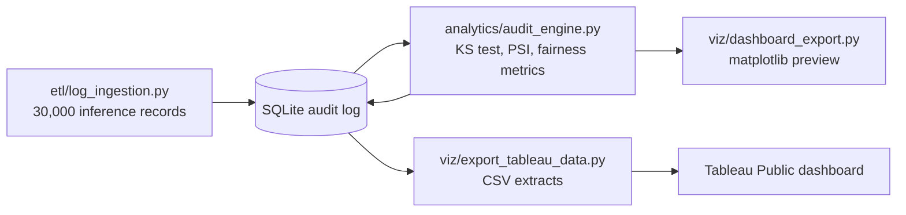
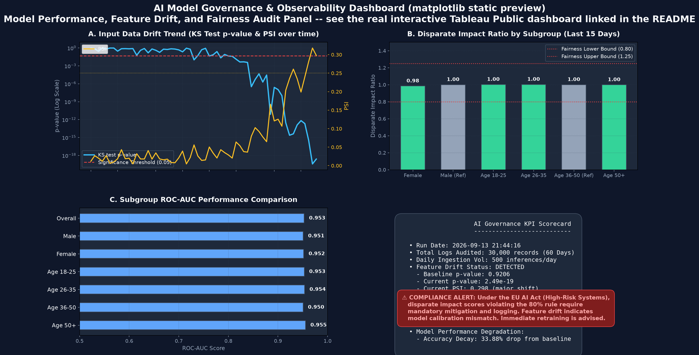

# AI Model Observability & Fairness Audits

[](https://github.com/Deshraj-Jogiya/AI-Model-Observability-Auditing/actions/workflows/ci.yml) 

Monitors a deployed model's inputs and decisions over time: Kolmogorov-Smirnov tests and the Population Stability Index catch feature
drift, demographic-parity and equal-opportunity metrics check fairness, and every audit is logged to SQLite and published as a Tableau
dashboard.

**Live dashboard:** [AI Model Observability & Fairness Audit on Tableau Public](https://public.tableau.com/app/profile/deshraj.jogiya/viz/AIModelObservabilityFairnessAuditDashboard)

## Highlights

- **Two drift signals that agree:** a KS test and a decile-binned PSI. PSI stays under 0.05 on stable days and climbs past 0.25 exactly
  where the KS p-value collapses.
- **Fairness audit:** disparate impact (four-fifths rule) and the equal-opportunity gap (true-positive rate, male minus female) by gender,
  and demographic parity across age groups, framed against high-risk AI rules (EU AI Act, US FTC). On the simulated model every day
  passes: disparate impact stays between 0.96 and 1.01 and the true-positive-rate gap under 1 point.
- **Audit log and reporting:** results land in a SQLite audit log, exported to CSV and published as a Tableau dashboard (a log-scale drift
  trend and a subgroup fairness comparison).
- **Guardrails:** each audit writes an `audit_alerts` row when a rule crosses its threshold (KS p < 0.01, PSI > 0.25, disparate impact
  outside 0.8 to 1.25, true-positive-rate gap over 10 points). On the simulated drift, which starts on day 31, the KS alert first fires on
  day 40, the same day accuracy has fallen 5 points, without needing any outcome labels; by day 60 accuracy is 33.9 points below baseline.
- **Less to review:** with the alert table a reviewer opens only the days that raised an alert, 21 of 60 (**65% fewer days**), and
  reads 25 alerts instead of 300 daily metric values (92% fewer).
- **Acting on the alert:** `analytics/retrain_response.py` retrains the model daily after the first drift alert on the latest week of
  outcomes that have arrived (7-day label delay). It cuts the accumulated accuracy loss by 32.6% and ends at 83.0% accuracy on the
  last day, against 66.0% for the untouched model.

Measured results, each with the question, the test and the decision: [docs/FINDINGS.md](docs/FINDINGS.md).

## Architecture





## Stack

Python, pandas, SciPy, scikit-learn, SQLite, SQL, Tableau, pytest, GitHub Actions.

## Run it

```bash
pip install -r requirements.txt
python etl/log_ingestion.py
python analytics/audit_engine.py
python viz/dashboard_export.py
python viz/export_tableau_data.py
python -m pytest tests/ -v
```

## Data

The 30,000 inference records are simulated, so the drift and fairness results describe the method, not a production model.
