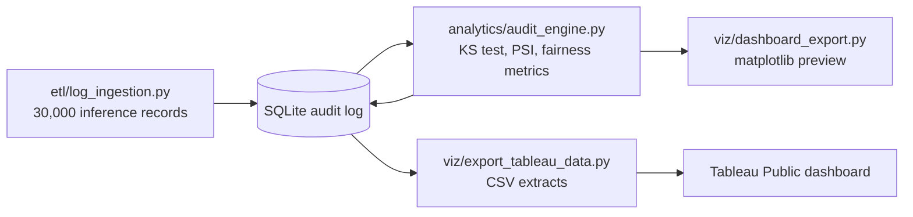

# AI Model Observability & Fairness Audits

[](https://github.com/Deshraj-Jogiya/AI-Model-Observability-Auditing/actions/workflows/ci.yml) 

Monitors a deployed model's inputs and decisions over time: Kolmogorov-Smirnov tests and the Population Stability Index catch feature
drift, demographic-parity and equal-opportunity metrics check fairness, and every audit is logged to SQLite and published as a Tableau
dashboard.

**Live dashboard:** [AI Model Observability & Fairness Audit on Tableau Public](https://public.tableau.com/app/profile/deshraj.jogiya/viz/AIModelObservabilityFairnessAuditDashboard)

## Highlights

- **Two drift signals that agree:** a KS test and a decile-binned PSI. PSI stays under 0.05 on stable days and climbs past 0.25 exactly
  where the KS p-value collapses.
- **Fairness audit:** demographic parity and equal opportunity per subgroup, framed against high-risk AI rules (EU AI Act, US FTC).
- **Audit log and reporting:** results land in a SQLite audit log, exported to CSV and published as a Tableau dashboard (a log-scale drift
  trend and a subgroup fairness comparison).
- **Guardrails:** validation checks raise alerts when input distributions move away from the training baseline.

## Architecture




## Stack

Python, pandas, SciPy, scikit-learn, SQLite, SQL, Tableau, pytest, GitHub Actions.

## Run it

```bash
pip install -r requirements.txt
python etl/log_ingestion.py
python analytics/audit_engine.py
python viz/dashboard_export.py
python viz/export_tableau_data.py
python -m pytest tests/ -v
```

## Data

The 30,000 inference records are simulated, so the drift and fairness results describe the method, not a production model.
